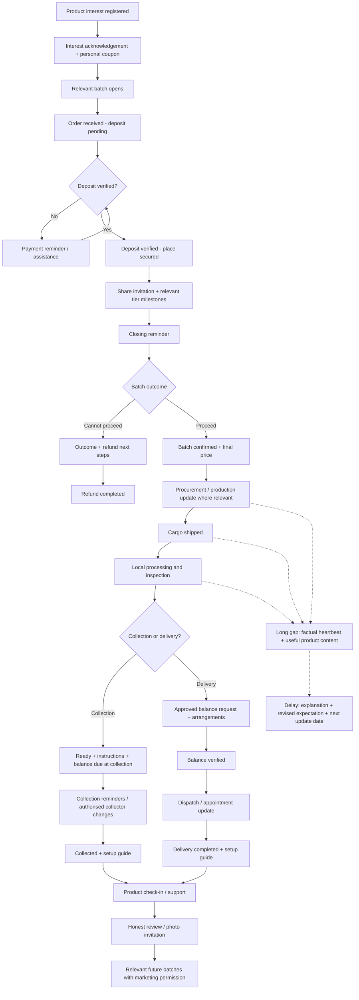

# SamaSama customer email journey

Recorded 12 November 2026. Working strategy reference; not approval to send, schedule or activate emails. Website copy: [How SamaSama Works](how-samasama-works-copy.md).

## Decisions and framing

- 16 November: interest registration will likely be the first customer touchpoint, but both interest and paid-order copy/backend readiness are required. The website-copy review is targeted for this week; this is not permission to send or activate unfinished workflows.
- Customer-facing name: SamaSama. Public support: hello@samasama.sg only. No published business address for now. Refund turnaround: 10 business days; this does not change refund eligibility.

- Marcus confirmed: registering product interest triggers the $10 coupon email; no separate customer qualification step. Combine acknowledgement and coupon in one immediate email.
- Current reward specification: S$10 per qualifying unit on the first paid order, any product with a final pre-reward price of at least S$50 per unit, up to ten units; six calendar months from issue, Singapore time. One personal code per registered email across the program. Use the same email at checkout. Deposit unchanged. See [reward rules and activation status](campaign-discounts-setup.md). Issuance is not established as live by this document.
- Early reward framing: “A thank-you for being here early.” Interest is not an order or a marketing subscription.
- Before final price locks, encourage sharing to help the group unlock a lower price. Once the best tier is reached, sharing invites friends to join before closing; it does not promise more savings or personal referral rewards.
- Deposit verified means a place in the batch, subject to the batch proceeding. Batch confirmed means the outcome/final price is confirmed. Do not collapse these into an ambiguous “order confirmed”.
- During fulfilment, lead with status, next step and next update date. Useful product content follows the update; it never conceals delays.

## Journey chart

Direct buyers enter at order received. Tier updates are conditional events, not prerequisites: a batch may close successfully without reaching the best tier. Share and milestone messages apply only to the customer's relevant open batch.

## Email register

| Message | Trigger / proposed timing | Main purpose / action |
|---|---|---|
| Interest + coupon | Successful eligible registration while reward issuance is enabled | Confirm product interest, deliver personal code and exact expiry/terms; no purchase implied |
| Batch opens | Relevant batch becomes available | Explain offer, tiers, deposit, timeline; join batch |
| Order received | Order submitted | Order summary, deposit instructions; complete deposit |
| Deposit reminder | Still unpaid; timing undecided | Help complete payment; stop when paid/cancelled/refunded |
| Deposit verified | Actual payment verification | Confirm amount and place; explain remaining batch condition; secondary sharing link |
| Share with friends | Proposed 1–2 days after verification, unless a milestone is due | Public batch link and truthful next-tier progress |
| First / further discount tier | Verified threshold reached | New achieved price, remaining milestone; share |
| Full discount unlocked | Highest tier reached | Celebrate best price; invite friends before closing without suggesting further reduction |
| Closing reminder | Proposed 48 hours before actual deadline | Buyers: share; interested non-buyers: join; reflect current price/tier |
| Batch confirmed | Approved successful outcome/final price | Final product total, reward, deposit, remaining balance and next step |
| Procurement / production | Actual relevant milestone | Explain work before shipment; do not imply every product is made to order |
| OTW 1: shipped | Confirmed cargo departure | Status and estimated arrival window; arrival is not collection readiness |
| OTW 2: processing / inspection | Actual local milestone | Explain remaining work; do not claim checks passed before completion |
| Waiting heartbeat | Proposed weekly during an extended wait | Status, next step/date, then useful product benefits, setup or care content |
| Delay update | Expected timeline materially changes | Known cause, revised estimate or uncertainty, next update date, support |
| Collection ready | Goods actually released and instructions confirmed | Location, hours/booking, outstanding balance due at collection, accepted deadlines/terms, collector option |
| Collection reminders | Relative to individual collection date / applicable period; offsets undecided | Upcoming date, rescheduling/support; overdue/free-period notices only under approved applicable terms |
| Collector change | Owner authorisation added/replaced/revoked | Notify owner and provide correction route; no invented pickup code |
| Delivery balance request | Admin-approved delivery payment step | Current balance, valid private link, charges/arrangements; collection customers excluded |
| Balance verified | Actual remaining payment verification | Confirm receipt and actual next step |
| Delivery update | Confirmed dispatch / appointment / exception | Actual schedule, tracking where available, rescheduling assistance |
| Collected / delivered | Recorded handover | Completion, setup/use guide, support |
| Product check-in | Proposed 3–5 days after receipt | Help achieve product benefit and surface issues |
| Review / photo request | Proposed 10–14 days after receipt | Honest feedback; pause during unresolved support cases |
| Future batch | Relevant offer and marketing permission | Useful next opportunity; stop irrelevant acquisition reminders after conversion |
| Exceptions / service cases | Payment mismatch, material order change, cancellation, refund or product issue | Specific facts, available choices and next step; separate refund initiation from settled refund |

## Sending principles and unresolved work

One primary action per email. Transactional clarity comes before promotional content. Deduplicate/coalesce routine updates around milestone sends. Send each milestone once to eligible recipients; re-check current order state before sending. Suppress stale payment/collection reminders and batch promotions after closure, cancellation or refund. Keep consent/preferences separate from necessary order notices. Use public links for sharing; never expose private order/payment/collector links or coupon codes in shared links.

Weekly progress cadence is approved in principle; its sender and final content are not activated. The other proposed timings and exact collection reminder offsets still need review. Operational launch details still needed: batch-specific timelines and checks, exact cancellation cutoff (refund turnaround confirmed as 10 business days), pickup instructions and applicable storage terms, delivery charges and scheduling, support ownership, warranty/replacement terms. Do not assume any future sender is implemented. Reconcile with [existing email register](customer-email-drafts.md), [manual balance flow](manual-balance-rollout.md) and [named collector flow](named-collector-rollout.md) before implementation.
